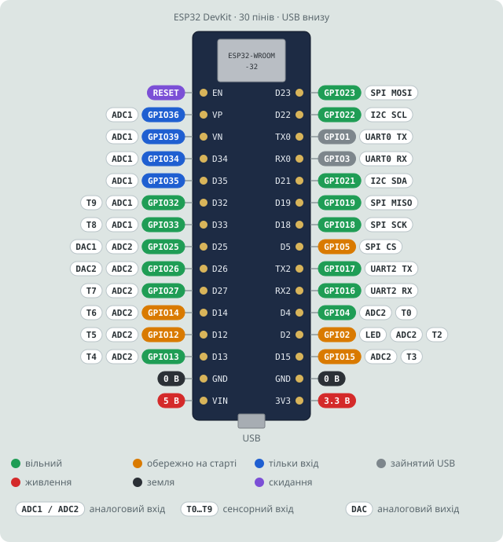
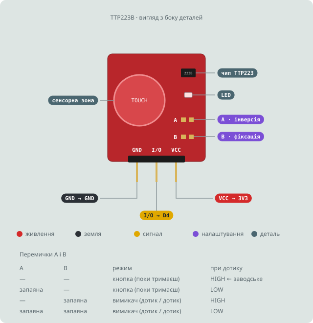

# Урок 0. Піни ESP32 і TTP223B

**Мета:** розуміти, за що відповідає кожен пін ESP32 DevKit і кожна деталь на модулі TTP223B, щоб не під'єднати щось не туди.

**Інтерактивна схема:** [`pins.html`](pins.html). Відкрийте файл у браузері з диска. Там при наведенні мишки на пін з'являється пояснення, а фільтри показують, які піни вміють ADC, Touch, I2C, SPI тощо.

## ESP32 DevKit (30 пінів)

Колір пігулки `GPIOxx` показує, наскільки пін вільний:

| Колір | Значення | Піни |
| --- | --- | --- |
| зелений | вільний, використовуйте сміливо | 4, 13, 16, 17, 18, 19, 21, 22, 23, 25, 26, 27, 32, 33 |
| помаранчевий | впливає на старт плати | 2, 5, 12, 14, 15 |
| синій | тільки вхід, без підтяжки | 34, 35, 36 (VP), 39 (VN) |
| сірий | зайнятий USB (Serial, прошивка) | 1 (TX0), 3 (RX0) |
| червоний / чорний | живлення / земля | 3V3, VIN, GND |

Сірі мітки поруч показують, що пін уміє:

| Мітка | Що це | Для чого |
| --- | --- | --- |
| `ADC1`, `ADC2` | аналоговий вхід, 0–3.3 В → 0–4095 | потенціометр, датчик рівня води, фоторезистор |
| `T0…T9` | вбудований сенсорний вхід (`touchRead`) | сенсорна кнопка просто з дроту або фольги |
| `DAC1`, `DAC2` | аналоговий вихід, 8 біт | плавна напруга, простий звук |
| `I2C SDA/SCL` | шина I2C за замовчуванням | MPU6050, RTC, компас — усі на двох дротах |
| `SPI …` | шина SPI за замовчуванням | SD-картка, дисплей |
| `UART2 TX/RX` | другий послідовний порт | GPS, зв'язок з іншою платою |
| `LED` | синій світлодіод на платі | blink без зовнішніх деталей |

ШІМ (`analogWrite`, `ledcWrite`) уміє будь-який пін, що може бути виходом: усі, крім синіх і сірих.

### Шість правил

1. На будь-який пін — **не більше 3.3 В**. Сигнал 5 В (Arduino, HC-SR04 Echo) спалить пін.
2. Пін дає ~12 мА спокійно, 40 мА максимум. Світлодіод — через резистор, мотор і реле — тільки через драйвер.
3. **ADC2 не працює, коли увімкнено Wi-Fi.** Аналогові датчики у Wi-Fi проєктах — на ADC1 (32–39).
4. `34, 35, VP, VN` — тільки вхід і без внутрішньої підтяжки.
5. Помаранчеві (2, 5, 12, 14, 15) впливають на старт. Якщо GPIO12 на старті HIGH, плата не завантажиться. GPIO2 під час прошивки має бути LOW.
6. `TX0 / RX0` зайняті USB: через них Serial і прошивка.

## TTP223B

| Що | Для чого |
| --- | --- |
| **VCC** | живлення 2.0–5.5 В. З ESP32 — на `3V3`, тоді й сигнал буде 3.3 В |
| **I/O** (OUT, SIG) | цифровий вихід: 0 або 1. На будь-який вільний пін ESP32, в уроці 1 — `D4` |
| **GND** | земля, на будь-який `GND` ESP32 |
| Сенсорна зона | працює крізь пластик, скло, фанеру товщиною кілька мм |
| Чип TTP223 | після ввімкнення ~0.5 с калібрується: не тримайте палець на сенсорі |
| LED | світиться при дотику: перевірка без коду |
| Перемичка **A** | запаяна → вихід інвертований (дотик = LOW) |
| Перемичка **B** | запаяна → режим вимикача (дотик вмикає, наступний вимикає) |

| A | B | Режим | При дотику |
| --- | --- | --- | --- |
| — | — | кнопка (поки тримаєш) | HIGH ← заводське |
| запаяна | — | кнопка | LOW |
| — | запаяна | вимикач | HIGH |
| запаяна | запаяна | вимикач | LOW |

Далі: [урок 1 — під'єднуємо TTP223B до ESP32](../01-touch-counter/README.md).

## Файли уроку

- `img/*.svg` — рисунки (GitHub показує їх прямо в цьому файлі).
- `pins.html` — інтерактивна схема, з неї ж згенеровані рисунки.
- `make-svg.mjs` — якщо змінили дані чи малюнок у `pins.html`, оновіть SVG командою `node make-svg.mjs`.
