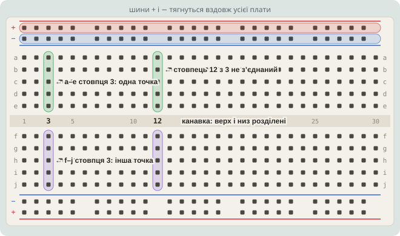
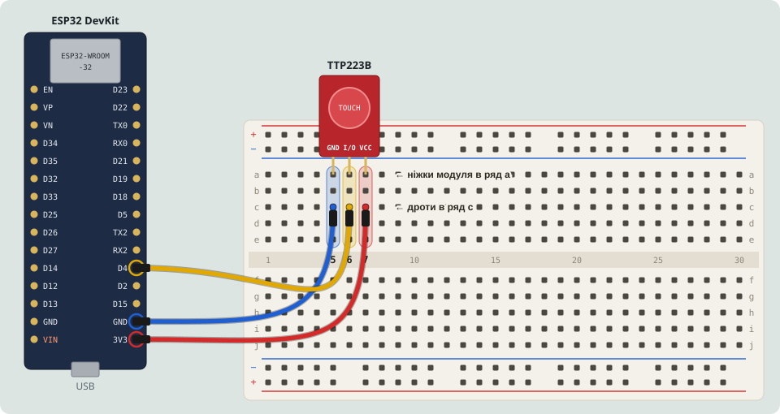
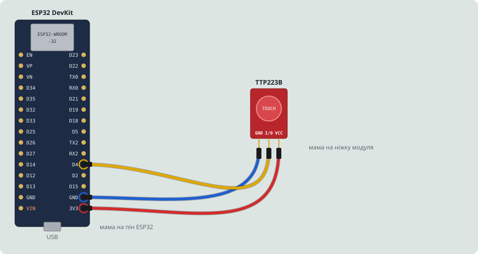

# Урок 1. Сенсорна кнопка TTP223B + ESP32

**Мета:** під'єднати сенсорний модуль TTP223B до ESP32 через макетну плату і побачити, як кожен дотик збільшує лічильник на вебсторінці.

**Код:** проєкт `C:\esp32\esp32-touch-counter` (див. [LOG.md](../../LOG.md), сесія 3).
**Інтерактивна схема:** [`wiring.html`](wiring.html). Відкрийте файл у браузері з диска: там можна перемикати варіанти й підсвічувати окремі дроти.

## Що потрібно

| Компонент | К-сть |
| --- | --- |
| ESP32 DevKit (30 пінів) | 1 |
| TTP223B | 1 |
| Макетна плата на 400 точок | 1 |
| Дроти «тато-мама» (M-F) | 3 |
| Кабель micro-USB (з даними) | 1 |

## 1. Як влаштована макетна плата

- П'ять отворів одного стовпця (`a–e`) з'єднані між собою. Це **одна точка** схеми.
- Нижня половина (`f–j`) — окрема група. Канавка посередині їх розділяє.
- Сусідні стовпці між собою **не** з'єднані.
- Шини `+` і `−` тягнуться вздовж плати. На дешевих платах вони бувають розірвані посередині.

Детальніше: [docs/breadboard.md](../../docs/breadboard.md).

## 2. Схема підключення

| Ніжка модуля | Макетка | Пін ESP32 | Колір дроту |
| --- | --- | --- | --- |
| GND | `5a` → `5c` | `GND` | синій |
| I/O | `6a` → `6c` | `D4` (GPIO4) | жовтий |
| VCC | `7a` → `7c` | `3V3` | червоний |

ESP32 лежить **поруч** з макеткою: 30-пінова DevKit широка і на платі на 400 точок закрила б майже всі отвори. Тому дроти «тато-мама»: «тато» вставляємо в макетку, «маму» надягаємо на пін ESP32.

> На малюнку ніжки модуля йдуть у порядку `GND · I/O · VCC`. На вашому модулі порядок може бути інший. Орієнтуйтесь на **підписи біля ніжок**: колір дроту відповідає підпису, а не номеру стовпця.

## 3. Порядок дій

1. Від'єднайте USB від ESP32.
2. Вставте TTP223B ніжками в ряд `a`, стовпці 5, 6, 7. Кожна ніжка у свій стовпець.
3. Прочитайте підписи на модулі: яка ніжка в якому стовпці.
4. Синій дріт: `5c` → `GND` на ESP32.
5. Жовтий дріт: `6c` → `D4`.
6. Червоний дріт: `7c` → `3V3`.
7. Перевірте червоний дріт очима: він має стояти саме на `3V3`. Тільки потім вставте USB.
8. Торкніться сенсора: на модулі засвітиться LED.
9. Телефон → Wi-Fi `ESP32-Counter` (пароль `12345678`) → <http://192.168.4.1>. Лічильник росте з кожним дотиком.

## 4. Варіант без макетки

Ті самі три з'єднання, але дроти **«мама-мама»** (F-F): штирі стирчать і на модулі, і на ESP32.

## 5. Перевірка перед USB

- Червоний дріт на `3V3`, **не** на `VIN` і не на `5V`. `VIN` стоїть у тому ж нижньому ряду, тільки з іншого боку плати.
- Три ніжки модуля стоять у трьох **різних** стовпцях.
- Кожен дріт стоїть у **тому самому** стовпці, що й його ніжка.

## 6. Якщо не працює

| Симптом | Причина | Що зробити |
| --- | --- | --- |
| LED на модулі не світиться | немає живлення | перевірити червоний (3V3) і синій (GND) дроти |
| LED світиться, лічильник стоїть | сигнал не доходить до D4 | жовтий дріт: той самий стовпець, що й I/O? пін саме `D4`? |
| ESP32 не стартує, гріється | коротке замикання | вийняти USB, перевірити, чи дві ніжки не в одному стовпці |
| Лічильник рахує сам собою | «плаває» вхід, немає спільного GND | перевірити синій дріт |
| Рахує навпаки (дотик = 0) | запаяна перемичка A інвертує вихід | розпаяти перемичку A або інвертувати в коді |
| Один дотик вмикає, другий вимикає | запаяна перемичка B (режим «фіксації») | розпаяти перемичку B |

## 7. Що відбувається в коді

- Пін 4 (GPIO4) працює як цифровий вхід. TTP223B сам видає чіткі 0/1, тому зовнішній резистор не потрібен.
- `digitalRead` на піні 4 повертає `HIGH`, поки палець на сенсорі (без перемичок на модулі).
- Лічильник збільшується лише на **фронті** (було `LOW`, стало `HIGH`), і не частіше ніж раз на 30 мс (антидребезг).

## Питання для самоперевірки

1. Чому дріт у `5c` з'єднаний з ніжкою в `5a`, а дріт у `5f` — ні?
2. Що станеться, якщо VCC модуля встромити в `VIN`?
3. Навіщо модулю та ESP32 спільний GND?

## Файли уроку

- `img/*.svg` — рисунки (GitHub показує їх прямо в цьому файлі).
- `wiring.html` — інтерактивна схема, з неї ж згенеровані рисунки.
- `make-svg.mjs` — якщо змінили малюнок у `wiring.html`, оновіть SVG командою `node make-svg.mjs`.
