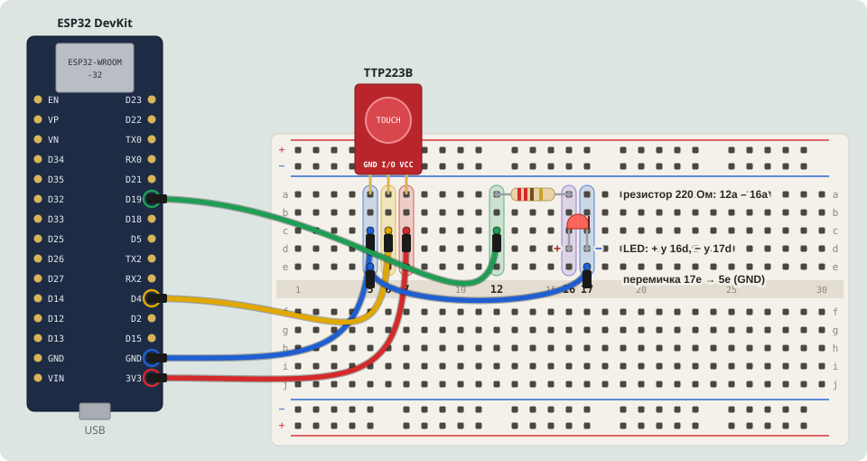
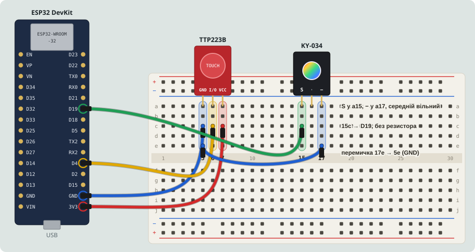

# Урок 2. Морзе-ключ зі світлодіодом

**Мета:** додати до схеми з уроку 1 RGB-світлодіод (4 ніжки), який світить червоним, поки палець на сенсорі. Крапка — короткий спалах, тире — довгий, як сигнальний ліхтар.

**Код:** [`projects/esp32-morse`](../../projects/esp32-morse) — світлодіод на `GPIO19` (`LED_PIN`).
**Інтерактивна схема:** [`wiring.html`](wiring.html). Відкрийте її в браузері з диска: при наведенні на деталь чи дріт з'являється пояснення.

## Що потрібно

Усе з [уроку 1](../01-touch-counter/README.md), плюс:

| Компонент | К-сть |
| --- | --- |
| RGB-світлодіод на 4 ніжки (або звичайний на 2, або модуль KY-034) | 1 |
| Резистор 220 Ом (червоний · червоний · коричневий) або 330 Ом | 1 |
| Дріт «тато-мама» | 1 |
| Перемичка «тато-тато» | 1 |

## Схема



| Що | Макетка | ESP32 | Дріт |
| --- | --- | --- | --- |
| TTP223B GND | `5a` → `5c` | `GND` | синій |
| TTP223B I/O | `6a` → `6c` | `D4` | жовтий |
| TTP223B VCC | `7a` → `7c` | `3V3` | червоний |
| Сигнал LED | `12c` | `D19` | зелений |
| Резистор → R (червоний) | `16a` ↔ `16d` | — | без дроту, через стовпець 16 |
| Спільна ніжка → земля | `17d` → `17e` → `5e` | через стовпець 5 | синя перемичка |
| G і B | `18d`, `19d` | — | поки ні до чого не під'єднані |

### Ніжки RGB-світлодіода

```
   R   спільна   G   B
   │     │       │   │
         └─ найдовша
```

- **Найдовша ніжка — спільна.**
- З одного боку від неї одна ніжка, це червоний (R). З іншого боку дві: зелений (G), потім синій (B).
- Спільна буває катодом (−, йде на GND, трапляється частіше) або анодом (+, йде на 3V3). Схема вище — для спільного катода. Як перевірити, див. «Якщо не працює».

Звичайний світлодіод на 2 ніжки ставиться так: довга (+) у `16d`, коротка (−) у `17d`.

Шлях струму:

```
D19 → дріт → стовпець 12 → резистор 220 Ом → стовпець 16 → LED (R → спільна) → стовпець 17 → перемичка → стовпець 5 → GND
```

Стовпець 5 — це GND модуля. У ньому ще є вільні отвори (`5b`, `5d`, `5e`), тож туди можна під'єднати все, що потребує землі. Окремий дріт до ESP32 для цього не потрібен.

## Порядок дій

1. Від'єднайте USB від ESP32.
2. TTP223B лишається, як в уроці 1: ніжки в `a5–a7`, дроти з `5c`, `6c`, `7c`.
3. Резистор 220 Ом: одна ніжка в `12a`, друга в `16a`. Яким боком — неважливо.
4. RGB-світлодіод у ряд `d`: червона ніжка в `16d`, найдовша (спільна) у `17d`, зелена в `18d`, синя в `19d`.
5. Перемичка «тато-тато»: `17e` → `5e`.
6. Дріт «тато-мама»: `12c` → `D19` на ESP32.
7. Вставте USB і прошийте проєкт: `cd projects/esp32-morse` → `pio run -t upload`.
8. Торкніться сенсора: червоний світить, поки тримаєте палець.

## Перевірка перед USB

- Ніжки резистора в **різних** стовпцях (12 і 16). Якщо обидві в одному, резистор нічого не обмежує, і світлодіод може згоріти разом з піном.
- Найдовша ніжка RGB у стовпці 17, червона — у стовпці 16, разом з резистором.

## Якщо не працює

| Симптом | Причина | Що зробити |
| --- | --- | --- |
| RGB не світить, сенсор працює | спільний анод замість катода | перемичку з `17e` на `7e` (3V3). Якщо червоний тепер світить постійно й гасне при дотику — це анод, логіку в коді треба перевернути |
| Звичайний LED не світить | світлодіод перевернутий | перевернути: від 3.3 В навиворіт йому нічого не буде |
| Не світить зовсім | розірване коло | пройти шлях струму вище: кожна ланка в правильному стовпці? |
| Світить ледь-ледь | синій або білий світлодіод: їм мало 3.3 В | узяти червоний або зелений, або резистор 100 Ом |
| Світить завжди | дріт на іншому піні | перевірити, що зелений дріт саме на `D19` |

Перевірити код без жодних дротів: поставте в `main.cpp` `LED_PIN = 2`. Тоді світитиме синій світлодіод на самій платі.

## Варіант: модуль 7 кольорів (KY-034)



Модуль має 3 піни: `S`, середній і `−`. Усередині світлодіода стоїть мікросхема, яка **сама** перебирає 7 кольорів. Ми можемо його тільки вмикати й вимикати, а вибрати колір не можна. Код той самий, що й для RGB.

| Що | Макетка | ESP32 | Дріт |
| --- | --- | --- | --- |
| `S` модуля | `a15` → `15c` | `D19` | зелений |
| `−` модуля → земля | `a17` → `17e` → `5e` | через стовпець 5 | синя перемичка |
| середній пін | `a16` | — | нікуди |

1. Від'єднайте USB. Якщо стояв RGB-варіант, вийміть RGB-світлодіод і резистор.
2. KY-034 у ряд `a`: `S` у `a15`, середній у `a16`, `−` у `a17`.
3. Перемичка «тато-тато»: `17e` → `5e`.
4. Дріт «тато-мама»: `15c` → `D19`.
5. Вставте USB і торкніться сенсора: модуль світить і переливається, поки тримаєте палець.

Чим цей варіант відрізняється від RGB:
- **Резистор не потрібен.** Мікросхема в світлодіоді сама обмежує струм (до ~20 мА, для піна ESP32 це допустимо). А з резистором при 3.3 В їй не вистачить напруги.
- **Кольори не керовані.** Кожен дотик заново вмикає мікросхему, тому вона, найімовірніше, щоразу починає з того самого кольору. Короткі крапки будуть однакові, а на довгому тире видно, як колір змінюється.
- **Не світить зовсім?** Перевірте, чи не переплутані `S` і `−`. Якщо все правильно, а світла немає, модулю замало 3.3 В: знадобиться транзистор і 5 В.

## Що змінилося в коді

```cpp
static const int LED_PIN = 19;   // світлодіод через резистор 220 Ом

pinMode(LED_PIN, OUTPUT);        // у setup(): пін працює як вихід

digitalWrite(LED_PIN, HIGH);     // палець торкнувся: 3.3 В на D19, світлодіод світить
digitalWrite(LED_PIN, LOW);      // палець прибрали: 0 В, світлодіод гасне
```

Новий інструмент тут `OUTPUT`: досі ESP32 тільки **читала** пін (`digitalRead`), а тепер сама **подає** на нього напругу (`digitalWrite`).

## Питання для самоперевірки

1. Чому мінус світлодіода можна під'єднати до стовпця 5, а не окремим дротом до GND ESP32?
2. Що буде, якщо обидві ніжки резистора встромити в стовпець 12?
3. Чим `pinMode(…, INPUT)` для сенсора відрізняється від `pinMode(…, OUTPUT)` для світлодіода?

## Файли уроку

- `img/wiring.svg`, `img/wiring-ky034.svg` — рисунки для RGB і KY-034 (GitHub показує їх прямо в цьому файлі).
- `wiring.html` — інтерактивна схема з перемикачем «RGB / KY-034», з неї ж згенеровані рисунки.
- `make-svg.mjs` — якщо змінили малюнок у `wiring.html`, оновіть SVG командою `node make-svg.mjs`.
