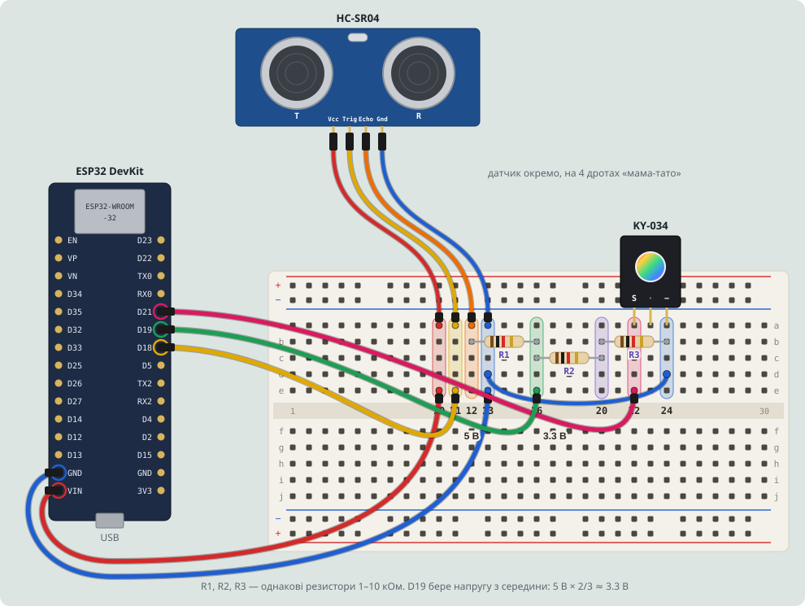

# Урок 3. Парктронік

**Мета:** зібрати далекомір, як у парктроніку авто. HC-SR04 міряє відстань ультразвуком, телефон показує сантиметри, а KY-034 блимає тим частіше, чим ближче предмет. Ближче 10 см він світить постійно.

**Код:** [`projects/esp32-parktronic`](../../projects/esp32-parktronic).
**Інтерактивна схема:** [`wiring.html`](wiring.html). Відкрийте файл у браузері з диска: при наведенні на деталь чи дріт з'являється пояснення.

**Нове в цьому уроці:** дільник напруги на резисторах (5 В → 3.3 В), вимірювання часу імпульсу (`pulseIn`), живлення модуля від 5 В.

## Що потрібно

| Компонент | К-сть |
| --- | --- |
| ESP32 DevKit | 1 |
| HC-SR04 | 1 |
| KY-034 | 1 |
| Резистори, **однакові**, будь-який номінал від 1 до 10 кОм | 3 |
| Макетна плата на 400 точок | 1 |
| Дроти «тато-мама» | 5 |
| Перемичка «тато-тато» | 1 |

## Схема



| Що | Макетка | ESP32 | Дріт |
| --- | --- | --- | --- |
| HC-SR04 Vcc | `a10` → `10e` | `VIN` (5 В) | червоний |
| HC-SR04 Trig | `a11` → `11e` | `D18` | жовтий |
| HC-SR04 Echo | `a12` → R1 | — | без дроту |
| Дільник R1, R2, R3 | `12b–16b`, `16c–20c`, `20b–24b` | — | резистори |
| Середина дільника | `16e` | `D19` | зелений |
| HC-SR04 Gnd | `a13` → `13e` | `GND` | синій |
| KY-034 S | `a22` → `22e` | `D21` | рожевий |
| KY-034 − і кінець R3 | `24d` → `13d` | через стовпець 13 | синя перемичка |

## Чому потрібен дільник

HC-SR04 живиться від 5 В, і сигнал на `Echo` теж 5 В. Пін ESP32 витримує максимум 3.3 В, тож 5 В його спалять. Дільник із трьох однакових резисторів ділить 5 В на три рівні частини:

```
Echo 5 В → R1 → стовпець 16 → R2 → R3 → GND
                    │
                    └── D19: 5 В × 2/3 ≈ 3.3 В
```

Загальна формула: `U(D19) = 5 В × (R2 + R3) / (R1 + R2 + R3)`. З трьома однаковими резисторами виходить 2/3 від 5 В, незалежно від номіналу. Якщо резистори різні, порахуйте самі: має вийти від 3 до 3.3 В.

`Trig` дільник не потрібен: на нього ESP32 сама подає 3.3 В, і модулю цього досить.

### Якщо резистори по 100 Ом

- **Для ESP32 безпечно.** Напругу визначає співвідношення, а не номінал, тож на D19 так само ≈ 3.3 В.
- **Echo навантажений сильніше.** Струм через дільник 5 В / 300 Ом ≈ 17 мА (з 1 кОм було б ~1.7 мА). Більшість HC-SR04 таке витримують, бо струм іде лише під час короткого імпульсу. Але якщо показання нестабільні або завжди «нічого немає», причина, найімовірніше, тут.
- **Спершу гляньте на звороті модуля.** Якщо там написано `HC-SR04P` або `3–5.5V`, живіть його від `3V3` замість `VIN`. Тоді Echo теж буде 3.3 В, і дільник не потрібен: `a12` → D19 одним дротом. Для звичайного HC-SR04 спроба від 3V3 теж безпечна, просто він може не міряти.

## Як HC-SR04 міряє відстань

1. ESP32 подає на `Trig` імпульс 10 мкс: «виміряй».
2. Модуль «кричить» вісьмома імпульсами ультразвуку 40 кГц. Людина його не чує.
3. Звук відбивається від предмета і повертається в приймач.
4. Поки звук летить туди й назад, на `Echo` тримається HIGH. ESP32 міряє цей час функцією `pulseIn`.

```
відстань (см) = час (мкс) / 58
```

Звук проходить ~343 м/с, тож на 1 см туди й назад він витрачає ~58 мкс. Узимку звук повільніший. Якщо показання розходяться з лінійкою, підправте `US_PER_CM` у коді.

## Порядок дій

1. Від'єднайте USB від ESP32.
2. HC-SR04 у ряд `a`, «очима» від себе: `Vcc` у `a10`, `Trig` у `a11`, `Echo` у `a12`, `Gnd` у `a13`.
3. Три однакові резистори: R1 `12b–16b`, R2 `16c–20c`, R3 `20b–24b`.
4. KY-034 у ряд `a`: `S` у `a22`, середній у `a23`, `−` у `a24`.
5. Перемичка «тато-тато»: `24d` → `13d`.
6. Дроти «тато-мама»: `10e` → `VIN`, `11e` → `D18`, `13e` → `GND`, `16e` → `D19`, `22e` → `D21`.
7. Ще раз перевірте зелений дріт: він у стовпці **16**, не 12.
8. Вставте USB і прошийте: `cd projects/esp32-parktronic` → `pio run -t upload`.
9. Телефон → Wi-Fi `ESP32-Parktronic` (пароль `12345678`) → <http://192.168.4.1>.
10. Наближайте долоню: число зменшується, KY-034 блимає частіше.

## Перевірка перед USB

- **Echo ніколи напряму на ESP32.** Зелений дріт до D19 стоїть у стовпці 16, а не 12.
- Червоний дріт іде на `VIN` (лівий бік ESP32, унизу), не на `3V3`.
- Усі три резистори однакові, і в кожного ніжки в різних стовпцях.
- KY-034 без резистора, мінусом у стовпці 24.

## Якщо не працює

| Симптом | Причина | Що зробити |
| --- | --- | --- |
| Завжди «нічого немає» | Echo не доходить до D19 | зелений дріт у стовпці 16? R1 справді з'єднує 12 і 16? |
| Завжди «нічого немає», а дроти правильні | HC-SR04 мало живлення | Vcc має бути на `VIN`, не на `3V3`; спробуйте інший USB-порт |
| Цифри стрибають | м'які або похилі поверхні розсіюють звук | цільтеся в рівну тверду поверхню: стіну, книгу |
| Показує на кілька сантиметрів більше чи менше | швидкість звуку залежить від температури | підправте `US_PER_CM` за лінійкою |
| KY-034 не блимає, цифри є | KY-034 не на тому піні чи не на землі | S у стовпці 22 → D21, мінус у стовпці 24 → перемичка на 13 |

## Що в коді

```cpp
digitalWrite(TRIG_PIN, HIGH);                 // імпульс 10 мкс: «виміряй»
delayMicroseconds(10);
digitalWrite(TRIG_PIN, LOW);
unsigned long us = pulseIn(ECHO_PIN, HIGH, 25000);  // скільки триває HIGH на Echo
float cm = us / 58.0;
```

Блимання: від 10 до 100 см період змінюється від 80 до 800 мс. Ближче 10 см світить постійно, далі 100 см не світить.

Вебсторінка щоразу через 150 мс питає `/api/state` і отримує `{"cm":37.4}` або `{"cm":null}`, коли відлуння немає.

## Питання для самоперевірки

1. Чому на `Trig` дільник не потрібен, а на `Echo` потрібен?
2. Яка напруга буде на D19, якщо R1 = 1 кОм, а R2 і R3 по 2 кОм?
3. Звук пролетів туди й назад за 2900 мкс. Яка відстань до предмета?

## Файли уроку

- `img/wiring.svg` — рисунок (GitHub показує його прямо в цьому файлі).
- `wiring.html` — інтерактивна схема, з неї ж згенерований рисунок.
- `make-svg.mjs` — якщо змінили малюнок у `wiring.html`, оновіть SVG командою `node make-svg.mjs`.
