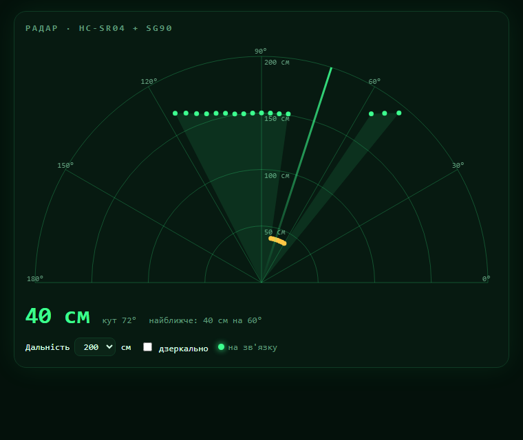
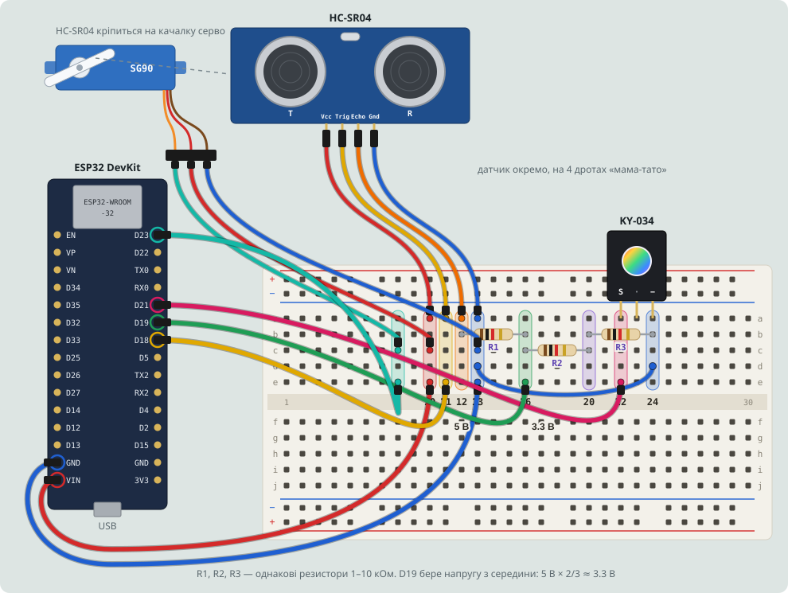

# Урок 4. Ультразвуковий радар

**Мета:** посадити датчик парктроніка на сервопривід SG90. Серво повертає його від 15° до 165°, ESP32 міряє відстань на кожному куті, а телефон малює екран радара з перешкодами.

**Код:** [`projects/esp32-radar`](../../projects/esp32-radar).
**Інтерактивна схема:** [`wiring.html`](wiring.html). Відкрийте файл у браузері з диска: при наведенні на деталь чи дріт з'являється пояснення.

**Нове в цьому уроці:** керування сервоприводом через ШІМ (довжина імпульсу = кут), синхронізація руху з вимірюванням, малювання на `<canvas>`.



## Що потрібно

Усе з [уроку 3 «Парктронік»](../03-parktronic/README.md), він має вже працювати. Плюс:

| Компонент | К-сть |
| --- | --- |
| Сервопривід SG90 | 1 |
| Дроти «тато-тато» | 3 |
| Дріт «тато-мама» | 1 |
| Двосторонній скотч, гумка або стяжка | щоб закріпити датчик на качалці |

## Схема



Схема уроку 3 не змінюється. Додається тільки серво:

| Що | Макетка | ESP32 | Дріт |
| --- | --- | --- | --- |
| Серво: сигнал (помаранчевий) | `8c` · `8e` | `D23` | бірюзові: «тато-тато» до `8c`, «тато-мама» з `8e` |
| Серво: +5 В (червоний) | `10c` | через стовпець 10 (VIN) | червоний «тато-тато» |
| Серво: земля (коричневий) | `13c` | через стовпець 13 | синій «тато-тато» |

Серво живиться від тих самих 5 В, що й датчик: стовпець 10 з'єднаний з `VIN`. Землю бере зі стовпця 13, як і вся схема.

## Як серво знає, на який кут стати

ESP32 50 разів на секунду (раз на 20 мс) посилає серво короткий імпульс. Кут задає **довжина** імпульсу:

| Імпульс | Кут |
| --- | --- |
| 0.5 мс | 0° |
| 1.45 мс | 90° |
| 2.4 мс | 180° |

```
імпульс (мкс) = 500 + 1900 × кут / 180
```

Усередині серво є мотор, редуктор і потенціометр на валу. Електроніка порівнює довжину імпульсу з положенням вала і крутить мотор, доки вони не зрівняються.

У коді імпульс робить апаратний ШІМ ESP32 (`ledcAttach` на 50 Гц), тож серво тримає кут, навіть поки ESP32 чекає на відлуння датчика.

## Як малюється радар

Кожні 70 мс ESP32 робить три кроки:

1. міряє відстань на поточному куті;
2. записує її в таблицю з 51 точки (15°, 18°, … 165°);
3. повертає серво на 3° далі, а на краю розвертається.

Повний прохід триває 51 × 70 мс ≈ 3.6 с. 70 мс вибрано не випадково: серво встигає стати на місце, а HC-SR04 не любить міряти частіше ніж раз на 60 мс.

Телефон кожні 120 мс забирає всю таблицю (`/api/state`) і малює точки: червоні ближче 30 см, жовті до 1 м, зелені далі. KY-034 світить, коли на поточному куті щось ближче 30 см.

## Порядок дій

1. Від'єднайте USB від ESP32.
2. Парктронік з уроку 3 лишається як є: датчик на дротах, дільник, KY-034, 5 дротів до ESP32.
3. Прикріпіть HC-SR04 до качалки SG90 (двосторонній скотч, гумка або стяжка), «очима» вперед. Дроти датчика мають вільно повертатися на 150°.
4. Три дроти «тато-тато» в роз'єм серво: помаранчевий → `8c`, червоний → `10c`, коричневий → `13c`.
5. Дріт «тато-мама»: `8e` → `D23`.
6. Вставте USB і прошийте: `cd projects/esp32-radar` → `pio run -t upload`.
7. Телефон → Wi-Fi `ESP32-Radar` (пароль `12345678`) → <http://192.168.4.1>.
8. Серво повільно ходить туди-сюди, на телефоні малюється радар.
9. Перевірте напрямок: поставте руку праворуч від датчика. Якщо точка з'явилася ліворуч, увімкніть «дзеркально» під радаром. Сторінка це запам'ятає.

## Перевірка перед USB

- **Роз'єм серво:** коричневий — земля, червоний — +5 В, помаранчевий — сигнал. Червоний іде в стовпець 10 (5 В з VIN), а не на `3V3`.
- **Дроти датчика** не натягуються на крайніх кутах. Для першого запуску краще зняти датчик з качалки й подивитися, як ходить серво.
- **Echo — як в уроці 3:** зелений дріт до D19 у стовпці 16, не 12.

## Живлення: головний ризик

ESP32 з Wi-Fi, датчик і серво разом можуть брати з USB більше, ніж він дає. Тоді в момент руху серво напруга просідає, і ESP32 перезавантажується. У Serial це видно так:

```
Brownout detector was triggered
```

Що робити:
- спробувати інший USB-порт або зарядку на 1–2 А замість порту ноутбука;
- дати серво **окреме 5 В**: наприклад, MP1584 від блока на 7–12 В, виставлений на 5 В. Червоний серво — на це 5 В, коричневий — і на мінус блока, і на землю схеми (стовпець 13). **Земля спільна обов'язково**, інакше серво не розуміє сигнал.

## Калібрування

| Що не так | Що змінити в `main.cpp` |
| --- | --- |
| Серво не доходить до краю | `SERVO_MIN_US` менше, `SERVO_MAX_US` більше (крок 50) |
| На краю дзижчить або впирається | навпаки, або звузьте `SWEEP_MIN` / `SWEEP_MAX` |
| Радар оновлюється повільно | `STEP_DEG = 5` (менше точок, швидший прохід) |
| Точки «тремтять» | `STEP_MS = 100` (серво має більше часу заспокоїтися) |
| Відстані розходяться з лінійкою | `US_PER_CM`, як у парктроніку |
| Ліво й право переплутані | галочка «дзеркально» на сторінці |

## Якщо не працює

| Симптом | Причина | Що зробити |
| --- | --- | --- |
| ESP32 перезавантажується, коли серво рушає | USB не тягне | розділ «Живлення» вище |
| Серво не рухається | немає 5 В або сигналу | червоний у `10c`, коричневий у `13c`, помаранчевий через `8c`/`8e` на D23 |
| Серво смикається хаотично | немає спільної землі | коричневий серво має бути з'єднаний з GND схеми |
| Серво ходить, а радар порожній | проблема в парктроніку | перевірте за уроком 3 і журналом сесії 5 (щуп `esp32-probe`) |
| Точки на одному куті «стрибають» | датчик ловить відлуння від дротів, столу, качалки | підніміть датчик вище над столом, дроти відведіть назад |

## Що в коді

```cpp
ledcAttach(SERVO_PIN, 50, 16);   // ШІМ 50 Гц, 16 біт

void servoWrite(int deg) {
  int us = SERVO_MIN_US + (SERVO_MAX_US - SERVO_MIN_US) * deg / 180;
  ledcWrite(SERVO_PIN, us * 65535 / 20000);   // частка імпульсу в періоді 20 мс
}

// кожні STEP_MS: виміряти → записати → повернути далі
scanCm[idx] = measureCm();
if (idx + dir < 0 || idx + dir >= N) dir = -dir;   // на краю розвернутися
idx += dir;
servoWrite(angleAt(idx));
```

## Питання для самоперевірки

1. Яку довжину імпульсу треба подати, щоб серво стало на 45°?
2. Чому між поворотом серво і вимірюванням є пауза, а не все відразу?
3. Навіщо серво спільна земля з ESP32, навіть якщо в нього окреме живлення?

## Файли уроку

- `img/wiring.svg` — схема (GitHub показує її прямо в цьому файлі).
- `img/screen-example.png` — як виглядає екран радара (тестові дані).
- `wiring.html` — інтерактивна схема, з неї ж згенерований рисунок.
- `make-svg.mjs` — якщо змінили малюнок у `wiring.html`, оновіть SVG командою `node make-svg.mjs`.
